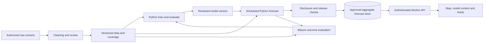

# Kerala movement forecasting: data, training and application plan

Prepared 8 November 2026 from the current implementation and primary references. This is a proposed plan; it does not establish data access, real-data performance or agency deployment. Collection quantities and acceptance targets below are project recommendations, not published guarantees of sufficiency.

Use the [official-facing request note](OFFICIAL_DATA_REQUEST.md) at meetings. This document explains what we would do with the records, which claims the data can support, and the software work needed. It complements [project.md](../../project.md), the [existing input contract](DATA_COLLECTION.md), [current model design](DESIGN.md), [heatmap data plan](HEATMAP_DATA_PLAN.md) and [pilot acquisition plan](PILOT_ACQUISITION_PLAN.md). It does not change the project vision or the accepted CLI schema.

## 1. The recommendation

Request **all eligible, de-identified episodes in a consistent Kerala reporting universe for January 2021 through the latest complete period**, preferably 36–60 usable consecutive months or more. Obtain four things together: dated outcomes, separately documented movement relationships, reporting/availability history, and stable geography. Seek historical observation effort next, then optional context. Request a 20–50-row sample and dictionary first so the large extract is actually usable.

Start with a pooled area model and a separately evaluated known-connection model. Treat a conditional destination model as the next experiment when movement labels and prediction-time inputs support it. Publish aggregate forecasts to the existing application through versioned data; keep model training and source records in a controlled Python environment.

The hard part is learning and evaluating a useful signal from biased, delayed and incomplete observations. Choosing a more complex algorithm cannot replace the missing outcome or movement records. **No dataset size guarantees 50% accuracy.** We can set a measurable 50% research target, determine whether the records support it, and report the result honestly.

## 2. Define the prediction before requesting the labels

| Product question | Training/evaluation label | Essential evidence | What it would establish |
| --- | --- | --- | --- |
| Where may relevant detections be documented next? | Distinct verified supply/movement-related detections in each area in a future 7/28-day window. Use a clearly labeled all-seizure target if classification is unavailable. | Event area/date/category, source scope, coverage and availability. | Forecasts of documented detections under the represented observation regime. |
| Which known connections may recur? | Distinct episodes with a documented directed origin–destination link during the future window. | Both endpoints, link status/meaning, mode, timing and movement-specific reporting coverage. | Recurrence of documented connections, not an exact journey. |
| Given a documented origin and information available today, which destinations are plausible next? | A later verified endpoint for a defined prediction unit, with a fixed candidate destination set. | Historical endpoint labels, the origin/input facts known at prediction time, and later independent endpoint verification. | Conditional destination ranking for the labeled population; not a statewide forecast without a trigger. |
| Where would an interception review be useful? | A separately defined later documented interception outcome and observation regime. | Historical checks including unsuccessful checks, detection results, aggregate effort, selection policy and dates; authorized prospective review. | Performance under that checking regime, not the hidden total flow or automatic operational success. |

**Distinguish intended and realized destinations.** A seized consignment may never reach its intended endpoint. A later verified account of its intended destination can label an *intended-destination* task; it is not evidence that the movement actually occurred. Directly observed legs, investigative inferences, reported claims and independently verified intended endpoints need different fields/statuses. Forecast each target separately where the records permit it.

A seizure in an area does not reveal the origin, destination, route or source of supply. Retain seizure-only records for the area model. Do not invent endpoints from nearby highways, an arrest location or the seizing office. Kerala-linked external places need stable identifiers as well; restricting every endpoint to the state's 14 districts would remove inbound/outbound logistics.

The Kerala Police public SLL table is annual aggregate context, not weekly movement labels. MHA's published trafficking table also distinguishes trafficking-related possession cases from overall NDPS activity, which is why we must ask the provider for its classification rather than treating every NDPS case as a supply movement. [Kerala Police statistics](https://keralapolice.gov.in/crime-statistics/sll-cases), [MHA/PIB trafficking response](https://www.pib.gov.in/PressReleasePage.aspx?PRID=2036398&lang=1&reg=3).

## 3. A defensible meaning for the 50% goal

Do not use overall yes/no accuracy across all area–time cells: when most cells are empty, predicting no events everywhere can score highly while finding nothing useful. Do not call `1 − WAPE` accuracy, a ranking score a probability, or interval coverage prediction accuracy.

### 3.1 Recommended primary research target

For the first statewide district experiment, provisionally rank the **top three of 14 eligible revenue districts for the next 28 days**, using only information available before issue time. Aim for **at least 50% event capture** on later unseen documented outcomes, and compare against the same shortlist from a simple recent-history baseline. State the actual land area selected and the source/coverage universe. This particular shortlist is a proposal, not an instruction to deploy resources.

```text
Event capture = eligible later episodes in selected areas / all eligible later episodes
Shortlist precision = selected area-windows with ≥1 eligible later episode / selected area-windows scored
Missed events = eligible later episodes outside the shortlist
```

These answer different questions. Capturing 50 of 100 later events is 50% event capture; it does not mean half of the selected areas had events or half of searches would succeed. A district-level precision score can be trivial if nearly every district has an event each month, so always report event concentration and baseline comparisons too.

For a five-area pilot choose a meaningful fixed budget before evaluation, for example one or two areas; selecting three of five can make 50% capture weak. For finer polygons agree an area budget as well as a shortlist size. If selected polygons cover half of the study area, state that clearly. Show capture versus selected area/budget curves; do not adjust the allowed area after seeing the final results. Area-normalized capture is established in hotspot evaluation, but results from other places/tasks do not predict performance here. [Original hotspot-ranking research](https://link.springer.com/article/10.1186/s40163-020-00112-x).

For known connections, define a separate fixed shortlist, such as the top 20% of the **predefined, eligible known connections**, and score future distinct linked episodes and connection-window precision. Record how many connections this means. Use a consistent non-overlapping connection definition or explicitly deduplicate episodes for event-capture metrics. Do not increase apparent capture by counting several legs of the same episode as several independent successes.

### 3.2 If “50% correct destinations” is the intended requirement

Define top-1 and top-3 destination hit rates separately. For example: among eligible later documented movement episodes with a prediction-time origin, did the independently verified endpoint appear in a previously issued three-destination list? State candidate count, endpoint semantics, origin eligibility, horizon, abstentions and event verification rate. A 50% top-3 rate across four candidates is a very different result from 50% top-1 across fourteen candidates.

Compare against the origin-conditioned most frequent destination, the latest known destination pattern and a source-consistent transition baseline. Do not silently omit poorly documented episodes: show label-available and label-unavailable counts by origin/time, since endpoint verification is selective. Do not call missing/unverified endpoints negative destinations. Multi-destination and multi-leg cases need an explicit labeling policy before fitting.

This conditional model is **not implemented today**. It also requires an agreed trigger: an authorized aggregate origin signal or a defined origin/time panel available before prediction. Supplying the true origin or substance from a later investigation to a historical forecast would leak the answer.

### 3.3 What would justify a performance claim?

Pre-register the target, area resolution, source universe, horizon, eligible population, shortlist budget, maturity delay and metric. For an initial research goal, propose 50% event capture and a practically useful improvement over the best simple baseline at the same budget. A **10 percentage-point capture improvement** is a suggested discussion target, not a guaranteed effect or a substitute for uncertainty. Report the achieved baseline even if it already captures more than 50%.

Score count quality with MAE/RMSE and, where meaningful, WAPE and Poisson deviance. State whether the method improves count error as well as ranking, since one need not improve the other. A 90% empirical prediction range needs its own measured coverage and width. Calibrated event probabilities, if later offered, need reliability plots and Brier/log scores on unseen outcomes, not just a well-ranked list.

Report point estimates and uncertainty, not just a pass/fail percentage. For scale only, under a simplified independent Bernoulli model, 50 successes out of 100 has a 95% Wilson interval of about **40.4–59.6%**; 200/400 gives **45.1–54.9%**; 500/1,000 gives **46.9–53.1%**. These are calculations, not training-size requirements. Actual events share weeks, areas and investigations, so use time-block/cluster-aware uncertainty and paired baseline comparisons; effective sample size can be much smaller. A point estimate of 50% does not establish that the underlying rate is at least 50%. [NIST interval method](https://www.itl.nist.gov/div898/handbook/prc/section2/prc241.htm).

## 4. Data quantities to negotiate

Ask for the complete permitted universe, not an artificial quota or a handpicked set of interesting seizures. The following ranges prioritize acquisition and budgeting; the first audit determines whether they support a particular resolution or model.

| Data component | Practical request | How we decide whether it is enough |
| --- | --- | --- |
| Format sample | 20–50 de-identified records plus dictionary, area list and sample coverage releases. | Can we interpret dates, IDs, categories, unknowns, joint cases and endpoint evidence without guessing? |
| Preferred detection history | 36–60 consecutive usable months; aim for 3,000–10,000+ relevant distinct episodes across a consistent state/pilot universe if available. Request January 2021 onward rather than stopping at a quota. | Events by area/horizon/category, reporting continuity, seasonal/regime changes, later evaluation density and learning curves. Large all-NDPS totals are not the same as relevant episodes. |
| Smaller feasibility extract | 24–36 months, at least five comparable covered entities and roughly 500–1,000 relevant unique episodes if available. | May support a pooled coarse baseline only. Merge geography or extend the horizon when sparse; do not imply statewide validation from a local pilot. |
| Movement subset | Aim for 1,000–3,000+ unique movement episodes with documented usable endpoints over ≥36 months; retain all available links and unknowns. | Repeated observations per origin/connection, endpoint status, arrival delays, verification selection, and hundreds of later label-eligible episodes where possible. A large number of one-off edges cannot support a precise edge model. |
| Coverage | Every entity/week/source scope across the requested period, with revisions and explicit unknown/suppressed periods. | Missing coverage cannot be repaired by adding more event rows. District seizure completeness does not imply complete origin–destination reporting. |
| Observation effort | The same period at area/week resolution, with measurement definitions and missingness. | Distinguish changes in checking/reporting from changes in documented patterns; evaluate by effort regime without claiming full bias correction. |
| Final evaluation | Prefer 6–12 later months, mature labels and hundreds of relevant outcomes across multiple windows where feasible. | Inspect time dependence, category/entity breakdowns and uncertainty; extend collection or narrow claims if events are sparse. A few large operations do not equal hundreds of independent outcomes. |
| Updates | Prefer weekly reviewed case/coverage releases; monthly is acceptable if it matches source maturity. | Measure event-to-availability/verification delay and show latency. Daily polling alone does not create timely ground truth. |

**Do not reject useful smaller data.** The movement subset may be much smaller than requested; that changes the supported task and uncertainty rather than authorizing invented links. If only monthly outcomes exist, design a monthly forecast/evaluation. If only annual outcomes exist, use them as background or a separate annual analysis.

Examples of scale: 14 areas × 156 weeks is **2,184 panel rows**; 14 × 260 is **3,640**. These are correlated area/week cells, not distinct seizures or independent experiments. A 28-day training window repeated every week also reuses events. One canonical episode may have several substance items, source reports and movement legs; these increase descriptive rows, not independent case count.

The current software's minimums—100 training entity-windows, 20 cases summed across training labels, 20 calibration entity-windows, eight covered weeks and five recent cases for inference support—are **engineering gates only**. In particular, overlapping training labels can count a case more than once in that 20-label check. The default four calibration origins need at least five fully eligible entities to reach 20 rows. These checks do not establish sufficient independent data or real-world accuracy. Keep them separate from acquisition targets and redesign the validation schedule if the received data requires it.

Build **chronological learning curves** using increasing amounts of earlier history while evaluating on fixed development windows, before opening the final holdout. Compare recent-only with longer history: older policy regimes may hurt. If error/capture improves as history grows, ask for more of that kind of data; if it plateaus, investigate label quality, coverage, features or target predictability. Generic random-fold learning curves are inappropriate here. [scikit-learn on learning curves](https://scikit-learn.org/1.7/modules/learning_curve.html).

## 5. Proposed collection tables and field dictionary

These are a **proposed staging contract**, designed to preserve raw information. They are not new accepted `corridor-ml` CSV headers. Existing exports are welcome; adapters should map them into these concepts and preserve their originals.

| Table / row meaning | Essential fields and definitions | Useful additions |
| --- | --- | --- |
| `source_manifest`: one source/extract | Source ID, provider, source scope, units included/excluded, period, extraction/version, permissions reference, timezone, codebook version and revision policy. | Retention/hosting limits, source contact by office/role, declared completeness and duplicate rules. |
| `areas`: one versioned geographic unit | Stable area ID/type, name/aliases, parent ID, source code, boundary version, effective dates and polygon or authoritative crosswalk. | Area in km², permitted external-area references and mapping uncertainty. |
| `episodes`: one canonical event | Anonymous canonical episode ID, provider/source-record reference, event date/range and precision, event area ID/version/precision, provider-defined category, evidence status, first-recorded/available/verified dates, revision/withdrawal history. | Detection context, historical aggregate operation reference, source-confirmed primary substance classification for current adapter. |
| `source_episode_links`: one report-to-episode relationship | Source-record ID, canonical episode ID, agency, source reference, duplicate/joint-case relationship, linkage basis/review date. | Agency-supplied cross-reference; uncertain matches retained for review rather than auto-merged. |
| `substance_items`: one episode/substance item | Episode ID, provider substance name and normalized group, identification/lab status, quantity, explicit unit, unknown/missing reason, availability/revision date. | Packaging/form category where releasable; no conversion of tablets to kilograms without a valid measurement. |
| `movement_links`: one episode/leg/version | Episode/link ID, origin and destination IDs/precision, direction, endpoint meaning, leg order, transport mode, link evidence basis/status, source reference, first-known/verified/withdrawn dates. | Ordered transit areas, separate intended/observed endpoints, reviewed connection to historical transport nodes. Unknowns remain explicit. |
| `coverage_releases`: one area/week/source/release | Entity/area and boundary version, week start/end, source scope, complete/partial/unavailable/suppressed, first release and revision date, completeness definition. | Expected/reporting units, reason for missingness, suppression rule. Movement coverage needs its own universe. |
| `observation_effort`: one area/period/method/source | Area/version, period, source, measure and unit, aggregate checks/hours/units checked, positive and no-seizure counts if available, release date, completeness and selection-policy description. | Historical method categories; changes in campaign/intensity; a flag for model-influenced checking in future evaluations. No current operational plans. |
| `reviewed_signals`: one canonical signal/version | Signal/source ID, publication/first-seen/verification dates, claimed event date, linked canonical episode or context entity, status, availability and withdrawal dates. | Independent corroboration reference and reviewed aggregate extracted fields. Raw tips stay outside training. |
| `area_week_outcomes`: aggregate alternative | Area/version, week, source scope, category, distinct episode count or unknown/suppressed flag, first release/revision date, definition and deduplication method. | Provider-produced distinct substance-category counts; multiple-substance categories are not added into overall totals. |
| `od_week_outcomes`: aggregate movement alternative | Origin/destination IDs, week, mode, endpoint meaning/status, distinct linked episode count, coverage, availability/revision and counting definition. | Separate transit/leg tables if available; consistent partitions prevent overlapping all-mode and mode-specific totals. |

### Time and location rules

- Preserve source timezone and date precision. For a weekly Kerala pilot, agree **Monday-start weeks in Asia/Kolkata**, use start-inclusive/end-exclusive intervals, and preserve original timestamps with offsets. The current CLI uses UTC calendar-day fields and Monday boundaries; choosing local-day aggregation requires a documented adapter/boundary-policy change and tests. A date-only record must not acquire a fabricated time.
- Event, registration, first availability, verification, publication, extraction and later correction dates are different. Use field/relationship-level availability when a destination is discovered months after the seizure. Never assign the episode's earlier verification date to a later-known endpoint.
- Preserve jurisdiction type and effective boundaries. A station address is not necessarily the event location. Do not assign a revenue-district centroid to a road/grid cell as a precise event.
- Do not infer a missing day from a monthly total. Keep original drug labels and explicit units while mapping broad groups. Keep substance identification revisions separate from the initial field assessment.
- A source-confirmed zero in a complete extract can be a count label. Missing, partial, suppressed and not-yet-released are different states. Unknown or suppressed counts are not zero; do not reverse-engineer small suppressed groups.

## 6. Sources and the meeting strategy

| Approach | Ask for | Priority and limitation |
| --- | --- | --- |
| Kerala Police records custodian through SCRB/DCRBs | Consistent detection history, category definitions, reporting-unit coverage, revisions and authorized movement extracts. | First priority for a coherent source universe. The [official directory](https://keralapolice.gov.in/page/rank-wise-details) is a routing source, not evidence that a particular office can release the data. |
| Kerala Excise records custodian | Equivalent history, range/jurisdiction crosswalks, movement fields and overlap guidance. | Seek one coherent extract first; keep source universes separate when joint-case deduplication cannot be established. Confirm the custodian through official department channels. |
| Narcotic Cells and appropriate central/transport agencies | Shareable historical documented movements and endpoint verification; relevant Kerala-linked detections and observation definitions. | Enhances logistics, but release and scope remain to be agreed. Do not assume a live integration. |
| Authorized GIS custodian / provider geography | Stable codes, permitted versioned boundaries, jurisdiction crosswalk and change log. | Needed before projecting reporting units onto a heatmap. |
| Public official releases, transport/geographic context | Reviewed recent cues, dated public road/rail context and aggregate relevant logistics activity. | Useful supplements, not the main historical labels. A transport link's existence is not a documented shipment. |

The public UNODC IDS download covers reported significant seizures and explicitly cautions that it is not the total picture of seizures or trafficking. Assess actual Kerala/India coverage before relying on it; it is not a substitute for a consistent local extract. [UNODC IDS coverage and limitations](https://dmpone.unodc.org/downloadIDS).

Take the official-facing note and ask for a small representative sample, dictionary and named office contact, followed by the full scoped extract. Seek parallel agency responses through the team, but consolidate outreach in a private tracker. The earlier [pilot pack](PILOT_ACQUISITION_PLAN.md) has contact-routing leads and draft letters; recheck addresses before use. No message is sent by this plan.

Before leaving the meeting record: available years, geographic units, rough counts by relevant category, known movement-field availability, missingness/coverage, release delay, sample/full-extract dates, permission scope, hosting restrictions, transfer method and update cadence. Agree what can be demonstrated publicly separately from what may be used privately for research. If data cannot leave the agency, offer an agency-controlled export or execution process; aggregate releases still need permission.

## 7. Raw-data cleaning and normalization

| Step | Work | Reviewable output / failure handling |
| --- | --- | --- |
| 1. Register receipt | Store the original extract read-only in an agreed controlled location; record file hashes, source version, scope and permission reference. | Intake manifest and immutable raw copy. No real data in Git, web seeds or public artifacts. |
| 2. Profile | Count rows, years, units, category and endpoint completeness, duplicate patterns, date precision and source delays. | A gap matrix by area/month/source; decide which tasks are possible before choosing the model. |
| 3. Extract | Parse CSV/XLSX/JSON; for approved redacted PDFs, record page/row references and verify extraction. | Traceable staging records and a quarantine queue. An optional LLM extractor does not verify a fact; approved processing and human source checks are still required. |
| 4. Canonicalize episodes | Use agency cross-references; identify joint cases and multiple reports. Preserve distinct seizures on different dates/places even if part of one investigation. | Canonical IDs and report-link table. Review uncertain duplicate matches; do not merge on date/location alone. |
| 5. Normalize time/geography | Resolve unambiguous dates, timezone and stable area IDs; use aliases for Malayalam/English names and a dated crosswalk. | Mapping decisions, unresolved locations and boundary versions. Do not geocode personal source text through a public service. |
| 6. Normalize classification/items | Preserve provider definitions, separate categories and substance items, convert compatible mass units, retain unknowns and test status. | Case counts independent of item count; no addition of grams/tablets or different drugs into one flow target. |
| 7. Review movement | Validate endpoint direction/meaning, evidence basis, leg order and when each claim became known. | Verified link table and explicit unknown/claim statuses. Area-only episodes remain usable without fabricated endpoints. |
| 8. Rebuild coverage/releases | Match provider completeness statements, missing/suppressed periods and effort tables to entity/time/source. | Versioned coverage panel. Never fill all periods “complete” merely to pass training checks. |
| 9. Reconcile | Compare derived counts with source totals at compatible scope/grain; account for classification, duplicates and excluded periods. | Reconciliation report, exclusion reasons and provider questions. Differences need explanation, not forced equality. |
| 10. Freeze a dataset version | Produce validated, reproducible training tables and hashes with a change log. | Data card, quality report and a documented decision about target/horizon/resolution. |

Suggested receipt review: check every ambiguous date/duplicate/endpoint and a stratified sample across files, years, agencies, categories and locations. Start with 50–100 sampled records where available, record errors by field and expand review when systematic errors appear. This is a proposed audit procedure, not a claim that sampling alone validates the extract.

Required identity, event time, area and source-scope errors block the affected rows/targets. Optional quantities/context may remain missing. Missing endpoint evidence blocks corridor labels without discarding a valid area episode. Report exclusions by area/source/time; otherwise cleaning itself can introduce selection bias.

## 8. Training and evaluation design

### 8.1 Data readiness and resolution

Inspect eligible episodes per area/week and 28-day window, nonzero-window frequency, coverage releases, delay distributions and source changes. Choose district or a consistent coarser pilot first when fine areas are sparse. A lower-resolution honest forecast is preferable to unsupported street-level colors. The decision to merge areas, change horizons or limit categories must use development data and domain meaning, not final-test success.

When only retrospective “latest truth” exists, do not claim a historically faithful real-time test. Collect first-known/revision history if possible; otherwise document the reconstruction, impose plausible delay scenarios, compare results under longer delays and begin prospective recording. Final case disposition can be an outcome/status field; it must not be a feature before it was known.

### 8.2 Baselines before complexity

Evaluate recent 4-week and 13-week covered-history rates, a persistence/recent-ranking method and a seasonal reference where sufficient comparable years exist. Keep zero/unknown handling consistent. For movement, add an origin-conditioned empirical transition/count baseline with smoothing learned only from past data. Compare identical populations, shortlist budgets and forecast origins.

Start the candidate count model with the existing Poisson histogram gradient booster and pooled area/connection features. Test regularized Poisson or negative-binomial/hierarchical alternatives if overdispersion or sparsity warrants them. Destination ranking can start with smoothed transitions and a modest conditional classifier/ranker. Use class weighting or resampling only within training data and evaluate on natural prevalence. Do not add neural/graph models until simpler candidates fail in an identifiable way and there are enough independent movement observations to evaluate the added complexity.

Useful candidate features: past counts at several lags, covered-week means/trends, seasonality, provider category and substance histories, historical quantity features, documented incoming/outgoing links, evidence/coverage/latency, past effort, and available aggregate logistics context. New fields require schema/feature changes; they do not become supported merely by appearing in a spreadsheet. Each optional feature must improve development performance and survive an ablation check.

Do not use current/future operation results, later-discovered endpoints, future realized transport/weather, raw tip counts, repeated article counts, personal characteristics or source-search activity as hindsight predictors. For revised records, reconstruct the version available at each origin.

### 8.3 Chronological split

For a well-covered five-year extract, a **proposed** layout is approximately the earliest 30 months for initial fitting, next 12 for rolling model/feature selection, next 6 for interval/probability calibration, and final 12 for untouched evaluation. Apply purge/maturity gaps, so these are allocation guidelines rather than a promise that all nominal months are usable. With only three years, use a smaller candidate set and a proposed 18/3/6/9-month allocation, again accounting for gaps and support; revise the schedule before evaluation if it cannot supply adequate selection/calibration/holdout observations.

For each origin `t`, use only features and source versions available by `t`; fit only on labels whose fixed maturity cutoff is at or before `t`. A target `[t, t + horizon)` is scored using the agreed release/verification maturity policy, not arbitrarily backfilled years later. Preserve late-arrival corrections for separately versioned secondary evaluations.

Primary evaluation should use non-overlapping 7/28-day targets, or explicitly block dependent windows when evaluating weekly-issued 28-day forecasts. Selection and calibration labels must mature before the next stage begins. Bootstrap paired model/baseline differences in time blocks, retaining spatial/episode grouping as appropriate; show the limited number of independent windows rather than interpreting thousands of overlapping rows as independent.

Time-aware evaluation matters: scikit-learn's lagged-forecast example demonstrates that shuffled train/test splits can give overly optimistic results. [scikit-learn time-series example](https://scikit-learn.org/1.7/auto_examples/applications/plot_time_series_lagged_features.html).

The current implementation uses 11 spaced origins: 3 selection, 4 calibration and 4 final holdout, spaced by horizon plus reporting delay. It provides a useful starting mechanism but only four final origins. Extending the holdout, calibration and ranking metrics to the agreed study is explicit implementation work, not already delivered behavior.

### 8.4 Failure analysis and model acceptance

Report per-origin and per-area/connection outcomes, micro and macro summaries, false-positive area-windows, missed episodes, selected land area/connection count, label missingness, data latency, uncertainty width/coverage and abstention rate. Include scores on all eligible units plus a clearly marked scored/forecast-only subset; do not hide difficult areas through abstention. Unknown outcome coverage is unscorable and should appear in the denominator accounting.

If classification/endpoint evidence permits, compare supply versus unknown categories, source agencies, known versus newly introduced entities and boundary/reporting regimes. A model trained on known corridors has not demonstrated unknown-corridor discovery. New-location/link generalization requires a distinct time-respecting experiment. Do not present sample imbalance or observation disparity as resolved merely because coverage was included as a feature.

Freeze the final metric, shortlist policy, model and calibration before scoring the final block. If it fails, preserve and report that failure. Refinement uses development data or new later outcomes; after tuning against the old holdout it is no longer untouched evidence for the new version.

## 9. Current software gaps that the data request must anticipate

| Capability | Current state | Work needed for this plan |
| --- | --- | --- |
| Canonical events and coverage | Strict local CSV schema; one primary substance per case; broad area/corridor targets. | Source adapters, richer category/items, source/episode linkage and revision tables. Keep raw staging separate from the existing strict inputs. |
| Geographic time policy | Monday weeks and UTC date boundaries. | Agree Kerala-local versus UTC aggregation; preserve source timestamps; adapt consistently and test boundaries. |
| Movement knowledge dates | Existing events have one documentation date, not independent dates for each endpoint/leg. | Relationship-level first-known/verification/withdrawal dates and historical snapshots. Never backdate later-discovered logistics fields. |
| Provider aggregates | Not accepted as training outcome rows. | An area/week and OD/week adapter plus direct count-label path, coverage, revisions and deduplication tests. Do not expand counts into fake cases. |
| Category targets | Four broad substance groups; all eligible cases together. | Provider-defined supply/personal-use/mixed/unknown filters, source-consistent definitions and category-specific outcome evaluation. |
| Conditional destinations | Not implemented. | Prediction trigger/unit, candidate registry, endpoint-label contract, baselines, ranking model and separate evaluation. |
| Evaluation | MAE-based selection, calibration and four final origins; top-three capture in reports. | Agreed 50% target metrics, budget/area curves, precision, blocked uncertainty, longer holdout and claim criteria. If selection optimizes ranking instead of MAE, reselect and recalibrate that method explicitly. |
| Model in the app | Static synthetic trained reports/local browser inspection; atlas overlay uses its frozen heuristic. | Versioned area/connection forecasts with geometry IDs and a read API. Keep target families and their provenance distinct. |
| Real sensitive data access | Owner-private hosting with switchable demo roles. | Membership-backed roles, appropriate record/aggregate access, approved storage/hosting/retention, audit and disclosure rules for the authorized pilot. |
| Refresh/monitoring | Manual local CLI; no default feeds/schedule/retraining. | Controlled jobs, validation, release review, atomic publishing, mature-outcome scoring and rollback. |

## 10. Application integration design

Use **scheduled aggregate forecast publication** first. The existing Python environment trains and runs inference; the Cloudflare application serves reviewed forecast data. There is no need to run scikit-learn inside a Worker or expose executable model uploads.



### Data contract and map behavior

Propose a run registry and versioned forecast rows, stored in D1 or a permitted equivalent. A forecast payload should include run/model/data version, synthetic/real flag, source universe, **target name and endpoint semantics**, issue time/information cutoff, data freshness, target start/end, horizon, entity/geography/boundary version, estimate/rank, empirical lower/upper range, coverage/support, abstention reason and validation reference. A selected-method field must distinguish the booster from a winning baseline. Include a publish status and immutable content hash.

Publish a complete run atomically, then update the active-run pointer. A new read endpoint such as `GET /api/forecasts?target=area&horizonDays=28` should enforce real membership permissions; it is proposed, not present. Do not place real aggregate JSON in the browser bundle by default: a hidden tab or demo role does not protect bundled assets. Choose private static storage only if access and refresh behavior are approved.

Join area forecasts to versioned polygons, color at the trained resolution and show uncertainty/coverage separately. Unknown/abstained areas should have explicit neutral states; no smoothing that implies unsupported detail. Draw directed connections schematically unless actual geometry is independently documented. Source road search remains geographic context; it cannot create model movement edges.

On selection, show the target, future window, cutoff/freshness, expected documented count or ranking, range, baseline, support, evaluation period and model version. Show prediction intervals as ranges, never a “confidence percentage” for wrongdoing. A brief can include the reviewed hypothesis and aggregate evidence within permissions. Preserve the independent synthetic demo as a labeled mode.

### Refresh and failure behavior

Forecast weekly when reviewed data is available; allow an explicitly versioned refresh after a material verified update. Retrain initially on a reviewed monthly cycle or a justified data/model change, rather than after every article. These cadences are proposals to align with provider latency and volume.

Reject invalid input, incompatible entity/boundary definitions or mismatched real/synthetic modes. If a release fails, retain the last reviewed run with its original dates and visible stale status; do not relabel it current. Define maximum acceptable data age with the provider, apart from the existing 13-week *model-age* check. Missing mandatory support should cause abstention, not a confident zero. Retain prior versions so a release can be rolled back and audited.

### Necessary verification work

Add meaningful checks for importer/canonical deduplication, multi-item case counts, local-time boundaries, field-level movement availability, coverage and aggregate-label equivalence on a controlled fixture. Test chronological selection/calibration purging, no training on raw tips, no untrusted model upload, geometry-version joins, atomic forecast publication, stale/abstention UI and membership restrictions. A future outcome round trip should match the saved run to mature labels without changing the original forecast.

## 11. Refinement after first training

| Observed problem | Next investigation/data request | Possible change to test |
| --- | --- | --- |
| Good training score, weak later performance | More independent time periods, fewer parameters, source/regime changes and leakage audit. | Simpler or more regularized pooled model; longer development evaluation. |
| Everyone predicts the same few districts | Is a persistent count baseline already strong? Is selected geography too broad? | Report baseline honestly; test supported finer areas and budget curves on development data. |
| Destination model fails | Endpoint unknowns, intended/realized mixing, late discoveries, rare origins and selective verification. | Better verified movement labels, coarser destination groups, smoothed transitions or abstention. |
| Recent “surge” follows more checking | Historical effort, reporting backlogs and campaign definitions. | Effort/regime features and sensitivity analysis, without claiming causal correction. |
| Wide ranges or many abstentions | Sparse events, missing coverage, outdated source releases or changed entity definitions. | Extend history/horizon, merge meaningful areas or obtain better coverage; retain abstention. |
| More news has no benefit | Repetition, delayed availability and no independent added signal. | Canonicalize/verify; remove raw volume; retain only available validated features that help. |
| Old history hurts | Changed definitions, enforcement, boundaries or routing patterns. | Compare recent windows and explicit regimes; do not assume more years always improve forecasts. |

Keep append-only forecast issue records. Log aggregate observation effort and whether later checking was influenced by a forecast. Otherwise the feedback loop can make the model learn where checks were sent rather than independent changes in movement. Published work demonstrates this risk for predictive systems trained on discovered incidents; merely adding effort as a feature does not establish an unbiased trafficking estimate. [Original feedback-loop research](https://proceedings.mlr.press/v81/ensign18a.html).

A prospective **shadow evaluation**, with forecasts fixed before outcomes arrive and no automatic actions, should follow retrospective work. Aim initially for 12–24 weeks, extending until enough mature outcomes and independent windows exist; this duration is a planning range, not sufficient evidence by itself. With a 28-day horizon and reporting delay, forecasts issued near the end cannot be scored immediately. Any subsequent operational study needs agency-defined evaluation and observation practice.

## 12. Delivery sequence, owners and decision gates

Effort below assumes usable access, a small team and reusable current code. It excludes agency turnaround and major document-extraction backlogs; ranges overlap where tasks are independent and are estimates, not a completion promise.

| Stage | Suggested owner | Deliverable / gate | Indicative effort after inputs arrive |
| --- | --- | --- | --- |
| A. Scope and sample | Team liaison + custodian | Written source scope/permission, representative sample, dictionary, geography and update discussion. | External turnaround unknown; 1–2 team days to review sample. |
| B. Intake audit | Data lead + provider reviewer | Versioned raw/staging data, quality/coverage/delay report and unresolved questions. Gate: which targets and resolution are supportable? | 2–5 working days for structured exports; longer for scans/inconsistent records. |
| C. Normalize | Data/ML developer | Canonical episodes/items/links, chronology, geographic crosswalk; tested event or aggregate adapter. Gate: trustworthy labels and enough mature windows? | 3–7 days, depending on source complexity. |
| D. Establish performance | ML developer + domain reviewer | Baselines, candidate selection, calibration, untouched evaluation, model/data cards and failure analysis. Gate: publish a forecast or a limited experiment/abstentions? | 3–5 days after dataset readiness. |
| E. Integrate | App developer | Protected forecast read API, versioned overlays, cutoff/uncertainty/evaluation display, approved aggregates and end-to-end checks. | 3–5 days; safe contracts/UI can be prepared during data work. |
| F. Improve | Custodian + ML/app owners | Periodic reviewed releases, mature-outcome scorecards, controlled retraining and shadow evaluation. | Ongoing; evidence accumulates over real time. |

For the **28 November 2026** demonstration, there are 20 calendar days from this note. Immediately prioritize sample/permission and a coherent coarse area extract; pursue movement evidence in parallel. By roughly 13 November, decide based on a received sample and a concrete full-delivery path whether a real-data evaluation/integration can be completed responsibly. A data commitment alone is not a completed training run. If records arrive too late, demonstrate the implemented synthetic pipeline and acquisition/cleaning status accurately; do not substitute a made-up 50% claim. Real-data work can continue after the event.

## 13. What to bring back from officials

The minimum useful result of the visit is **a named authorized custodian, a sample plus dictionary, a defined history/geographic scope, a coverage/release explanation, movement-field availability, permitted-use terms and a next delivery date**. The best result is a consistent event or aggregate series with separately evidenced logistics links and a path to later updates.

If officials can provide only one main package, choose the dated area-level outcome history **with reporting coverage and source definitions**, and explicitly request the linked movement subset as the next priority. If we obtain seizures without links, we can test a detection forecast; if we obtain credible endpoint history and its timing, we can test the logistics question. Those are different achieved capabilities and should be named accordingly.

## Primary references checked for this plan

- [Kerala Police SLL statistics](https://keralapolice.gov.in/crime-statistics/sll-cases): public annual context; not a weekly movement training extract.
- [MHA/PIB: Drug Trafficking in the Country](https://www.pib.gov.in/PressReleasePage.aspx?PRID=2036398&lang=1&reg=3): distinguishes trafficking-related case statistics.
- [Kerala Police official directory](https://keralapolice.gov.in/page/rank-wise-details): routing reference; disclosure authority and current recipient must be confirmed.
- [UNODC public IDS download](https://dmpone.unodc.org/downloadIDS): significant reported seizure events and explicit coverage/interpretation limitations.
- [scikit-learn 1.7 lagged forecasting example](https://scikit-learn.org/1.7/auto_examples/applications/plot_time_series_lagged_features.html): time-aware evaluation, count models and uncertainty; matching the project's pinned library family.
- [scikit-learn 1.7 learning curves](https://scikit-learn.org/1.7/modules/learning_curve.html): assess benefit from additional training samples; apply chronologically here.
- [Mohler et al., Learning to rank spatio-temporal event hotspots](https://link.springer.com/article/10.1186/s40163-020-00112-x): capture and selected-area accounting; no performance transfer to this project is claimed.
- [NIST: confidence intervals for proportions](https://www.itl.nist.gov/div898/handbook/prc/section2/prc241.htm): Wilson intervals; independence simplification is explicitly limited above.
- [Ensign et al., Runaway Feedback Loops in Predictive Policing](https://proceedings.mlr.press/v81/ensign18a.html): observation feedback as a modeling/evaluation risk.

Numerical acquisition ranges, proposed shortlist targets, quality workflow, delivery estimates and application architecture are this project's planning judgments. They should be revised after the sample/coverage audit and agreed with the provider; none imply guaranteed prediction performance or authorization.
