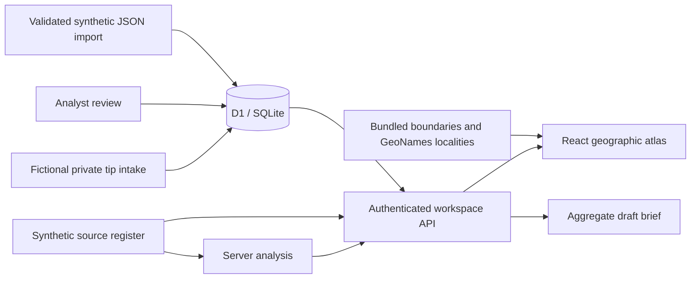

# Architecture and boundaries

## Flow

The atlas uses Leaflet. Online OpenStreetMap standard raster tiles supply detailed roads and labels; all tiles are visually grayscale. Bundled district polygons and 6,364 GeoNames locality points remain independent of the basemap. Only visible place points are drawn at zoom 11+, with labels at zoom 14+. Locality search is entirely browser-local; it never sends search terms, records or tips to the tile provider. Geographic precision does not increase the precision of synthetic district-level evidence.

The frozen forecast uses only the committed scenario, with event, availability and review cutoffs. New imports and review exercises affect the evidence workspace but do not silently change the experiment. This makes the presentation and evaluation reproducible. A production model would need versioned snapshots, explicit retraining and independent validation.

## Evidence

Districts are nodes; fictional documented connections are edges. A seizure location is a separate property, never sufficient to derive an edge. Intermediate districts in the synthetic corridor registry are fictional scenario attributes, not geocoded roads. Unknown quantities are null. Source dates, availability, review dates and qualitative confidence are separate fields. Imported records are schema-validated and immutable; review events append rather than replace source payloads. The displayed current assessment overlays these events.

## Forecast

Target: expected **number of documented cases over the next 30 days** per corridor. Model: 0.6 times the last-30-day count + 0.3 times the preceding-30-day count + 0.1 times the preceding-30-day count. Baseline: all eligible records in the preceding 90 days / 3. Neither is a calibrated probability.

Six monthly prediction dates from May to October 2026 use disjoint 30-day targets (some days between folds are not evaluated). Training excludes events on/after cutoff and information or reviews available after cutoff. Outcome labels are the scenario known by 1 November 2026. Report mean absolute error across ten corridors, captured cases in the top-three ranking and active corridors outside that ranking. No tuning on held-out results. No actual enforcement-coverage information exists. Synthetic results are a software/workflow demonstration only.

## Access

Hosted access is owner-private, enforced by Sites. Request identity comes from dispatch-owned authentication headers; the hosting boundary must strip caller-supplied identity headers. Local sign-in is provided only by the portable development integration and is absent from production builds. API routes independently require identity for case/lead reads and authenticated writes.

Analyst/planner selection is deliberately a **switchable simulation**, stored in an HttpOnly SameSite cookie. Planner restrictions are applied on the server. This is not a membership-backed role system. Never expose this prototype with real sensitive data or treat a chosen demo role as agency authorization.

Imports, reviews and briefs are scoped by the stable signed-in user ID. Fictional tip intake is shared with signed-in analyst demonstrations, and has a bounded hourly intake cap. It returns a receipt, never lead contents. Cross-origin writes are rejected and request size is bounded; schemas constrain lengths, synthetic-only content and dates. D1 statements use parameter binding. React escapes source text. No arbitrary HTML rendering or external file retrieval is used.

## Privacy and operational gaps

No real records, names, IDs, patients, students or live tracking are needed. The prototype does not automatically detect personal information typed by a user; fictional-only labels and schemas are not a production data-loss-prevention control. Do not enter real sensitive data.

Anonymous local intake requires no account, but anonymity is not guaranteed. Hosting access logs can exist; the private hosted gate itself requires sign-in. Optional fictional contact is stored without field-level encryption. Production needs agreed retention/deletion, encryption and key-management decisions, abuse prevention, access auditing, membership roles, security review, independent privacy assessment and agency authorization.

The five-record brief suppression threshold is demonstrative and not a privacy guarantee. Service planning needs independent local capacity/access information. Briefs are saved drafts; export is user initiated. No operational reports are sent automatically.
